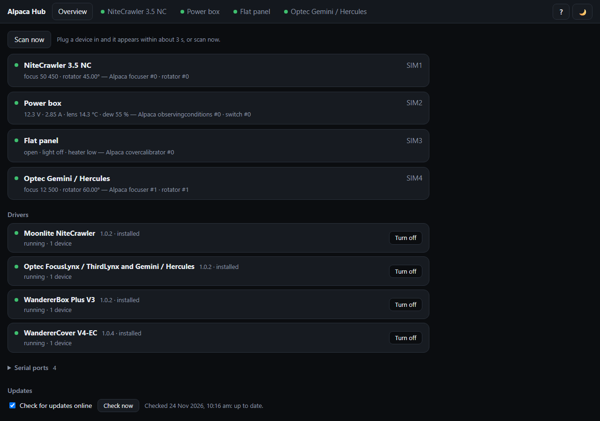

# Alpaca Hub

**One ASCOM Alpaca service for every device on a telescope PC.** The same program goes on every setup. It finds
whatever is plugged in, serves all of it at one address with one Alpaca discovery responder, and shows a status page
with a tab per device that is present. Devices that aren't connected are left out, of the page and of the Alpaca
programs' device lists. A device plugged in later appears within about 15 s, or at once with **Scan now** on the Overview.
The Overview also charts every device's readings together on one time axis (temperatures, power, positions, dew,
or any mix), with values of the same unit on one scale.

**[Read the guide](docs/guide/README.md)**: what it does, installing, the Overview, each device's page, imaging
programs, updates and troubleshooting, with screenshots.



## Quick start

1. **Download** from the [latest release](https://github.com/ScaleDIN/alpaca-hub/releases/latest): the hub,
   `AlpacaHub-<version>-Setup.exe`, and the driver installer for each of your devices:

   | Device | Alpaca devices | Installer |
   |---|---|---|
   | Moonlite NiteCrawler (WR25 / WR30 / WR35) | Focuser, Rotator | `AlpacaHub-nitecrawler-…-Setup.exe` |
   | WandererBox Plus V3 | Switch, ObservingConditions | `AlpacaHub-wbox-…-Setup.exe` |
   | WandererCover V4-EC | CoverCalibrator | `AlpacaHub-wcover-…-Setup.exe` |
   | Optec Gemini / Hercules, FocusLynx / ThirdLynx | Focuser, Rotator | `AlpacaHub-optec-…-Setup.exe` |

2. **Install the hub first**, then the drivers (Windows 10 or 11, 64-bit). The installers aren't code-signed yet,
   so Windows may warn about an unknown publisher: *More info*, then *Run anyway*. The hub's installer offers to start
   it when you log on, and to let phones and other computers on a private network reach it.
3. **Plug the devices in and start the hub** (Start menu: *Alpaca Hub*). Its page opens at
   [http://localhost:11111/](http://localhost:11111/): an Overview with every device found, a tab per device, and a
   chart of their readings.
4. **In your imaging program** (any ASCOM Alpaca client), let it discover Alpaca devices, or add this PC's address
   with port 11111. Every device is there, numbered across brands (Focuser #0, #1 …), and keeps its number.
5. **Updates:** the hub looks for new versions once a day and shows them on the Overview, where *Install* updates it
   on the hub's PC. The Overview's *Updates* setting turns this off.

More in [the guide](docs/guide/README.md), and in the short user guide installed with the hub (Start menu: *User
guide*, or the **?** on the page). Moving from the devices' older standalone services? Read
[Before the first start](docs/guide/2-install.md#3-before-the-first-start).

What changed in each version: [CHANGES.md](CHANGES.md). MIT licence ([LICENSE](LICENSE)). Issues and pull requests
are welcome; a new driver is a folder of its own ([docs/WRITING-DRIVERS.md](docs/WRITING-DRIVERS.md)).

## For developers

- **The hub is fixed; drivers are separate.** Each driver is a folder with its own installer, runs in its own process,
  and can be installed, updated or removed while the hub runs (Overview's Drivers list). A driver that crashes or
  hangs is restarted on its own; the other devices carry on.
- Drivers: `nitecrawler` (Moonlite NiteCrawler: Focuser + Rotator), `wbox` (WandererBox Plus V3: Switch +
  ObservingConditions), `wcover` (WandererCover V4-EC: CoverCalibrator), and `optec` (Optec FocusLynx / ThirdLynx and
  Gemini / Hercules), each in `drivers/`. The hub itself has no driver.
- Checked on the real devices through the hub: ConformU passes on the NiteCrawler's Focuser and Rotator, the box's
  ObservingConditions and Switch (apart from ConformU's known issue for a switch with a negative minimum), and the
  Hercules' Focuser and Rotator (firmware 1.3.1 and 2.0.1). The FocusLynx / ThirdLynx side is checked against its
  simulator only. A driver process killed mid-move comes back with its client still connected.
- `python tools/run_tests.py` runs the hub's tests and each driver folder's own (against simulators), the files side
  by side: about 1½ minutes. `python -m unittest discover -s tests` runs the same tests one after another (~6½ min).
- **Installers**: `python packaging/build.py all` (below). **Writing a driver**: [docs/WRITING-DRIVERS.md](docs/WRITING-DRIVERS.md),
  with a working example in [docs/example-driver/thermo](docs/example-driver/thermo).

## How it works

```
Client/phone ──► hub :11111 ──┬─► NiteCrawler instance (127.0.0.1:random)  Focuser, Rotator
                              ├─► WandererBox Plus V3 instance               Switch, ObservingConditions
                              ├─► WandererCover V4-EC instance               CoverCalibrator (+ its own page)
                              ├─► Optec FocusLynx / ThirdLynx instance       Focuser (1 or 2) (+ its own page)
                              └─► Optec Gemini / Hercules instance           Focuser, Rotator (+ its own page)
```

- **Drivers** (`drivers/<key>/`, installed: `%ProgramData%\AlpacaHub\drivers\`) are one
  per brand/model, each in its own process. A driver says how to recognise its device and runs it. An
  *instance* is one device found: its own Alpaca server and status page on a private 127.0.0.1 port. The hub
  forwards to it, with the caller's address in `X-Forwarded-For`. That header is trusted only from 127.0.0.1, so
  "settings only from this PC" still holds.
- **Public device numbers are the hub's.** Focuser #0, #1, #2 … are counted across all brands. Each Alpaca device
  keeps its number, saved by UniqueID in `hub.json`, so an imaging program's profile stays valid on a night when another device
  is missing.
- **Several units of one model** each get an instance, a tab (`/nitecrawler/`, `/nitecrawler-2/`), their own
  settings and distinct UniqueIDs.
- **One rule for IDs and settings (hub API 1, 2026-11-22).** A unit is the device's own serial number when it
  reports one (NiteCrawler, Optec), else the USB chip's serial number, else the COM port (the box and the panel).
  UniqueID = uuid5(URL namespace, `alpaca-hub:<driver key>:<unit>:<device>`); settings in
  `%LOCALAPPDATA%\alpaca-hub\drivers\<driver key>\<unit>.json`. Settings from before (the standalone services' files
  for the first unit, `wbox-…`, `nitecrawler-…`, `optec-gemini-…` in the hub's folder) are copied there once. The
  Alpaca numbers saved for the old UniqueIDs were cleared once, so devices are numbered afresh. A box or panel moved
  to another USB socket gets a new COM port, and so new settings and UniqueIDs.

### Finding devices safely
A driver lists the USB IDs it may look at, and the hub enforces three rules:
1. **Never open a port no driver claims.** Bluetooth COM ports, for example, can hang on open.
2. **Listen before talking.** The box and the panel send status lines on their own, so they're recognised
   without a byte being sent.
3. **Ask only a port that stayed silent, and only with the driver whose USB IDs match**, in order of the
   drivers' `probe_priority`. This matters: the WandererBox treats any input as a number and stores every command in
   EEPROM, so it must never receive another device's question. Its driver lists the CH340's IDs in `never_probe`,
   and the hub refuses (logs and doesn't run) any driver that would probe them.

| Device | USB | Baud | Recognised by |
|---|---|---|---|
| NiteCrawler | FTDI 0403:6015 / 6001 | 57600 | silent; answers `PF#` → `3.5 NC`, `PS#` → serial |
| WandererBox Plus V3 | CH340 1A86:7523 | 19200 | sends `ZXWBPlusV3A…` every second |
| WandererCover V4-EC | CH340 1A86:7523 | 19200 | sends `WandererCover…` every 0.33 s |
| Optec ThirdLynx / FocusLynx | 04D8:ED77 (ThirdLynx), FTDI 0403:6001 (Optec cable) | 115200 | silent; answers `<FHGETHUBINFO>` with `HUB INFO`, `<FHGETVER>` (ThirdLynx only) |
| Optec Gemini / Hercules | FTDI 0403:6001 (Optec cable) | 115200 | silent; answers `<H1nnGETCFG>` with `Firmware = …` |

On an FTDI port the NiteCrawler is asked first; the Optec questions only reach a port that didn't answer as one.
The Optec drivers turn DTR and RTS on for their port, as Optec's own drivers do (USB CDC firmware may wait for DTR).
The box and the panel (CH340) are opened with DTR and RTS on, as Wanderer Empire and INDI open them: the panel
only talks with them on (2026-11-20). The NiteCrawler keeps them off. No bytes are sent either way.

**Optec safety:** the hub sends Optec hubs status questions, moves, halt, home, sync and (Gemini rotator, from
Alpaca) reverse. It never sends a configuration command: device type, maximum travel, backlash and temperature
compensation stay as Optec's FocusLynx Commander / Gemini Commander set them. Optec warns that a wrong device type
can damage a focuser. A Gemini/Hercules rotator that isn't homed refuses moves; home it from its tab.

## Run

```bash
pip install -r requirements.txt
python -m hub                                   # real serial ports, http://localhost:11111/
python -m hub --simulate nitecrawler,box,panel,lynx,gemini --http-port 11288   # simulated devices (any mix, repeats allowed)
python tools/run_tests.py                      # all tests, files side by side
```

Settings and the log are in `%LOCALAPPDATA%\alpaca-hub\` (simulation uses a `sim` subfolder).
Each driver module runs in its own process (`python -m hub --driver <module>`, started by the hub); its log is
`logs\<module>.log` there. `--in-process` runs them inside the hub instead, for debugging only.
Drivers are also found in `%ProgramData%\AlpacaHub\drivers\<key>\<version>\` (installed; `driver.json` written
last) and `drivers\<key>\` here (source), while the hub runs. Overview's Drivers list shows each one's version and
state, turns it off and on, and switches to a waiting update.
Stop any standalone service (an old wbstock or ncalpaca install) first: only one program can own a COM port.

**Development note:** with the Python Install Manager, the `python` command is a packaged-app alias
(`WindowsApps\python.exe`), and that gets a filtered view of `%LOCALAPPDATA%`. It doesn't see
`ncalpaca\settings.json` or `wbstock\settings.json` and silently runs with defaults or older private copies:
NiteCrawler focus max 999999 instead of yours, and other dew settings for the box. Calling the interpreter by its
full path (`%LOCALAPPDATA%\Python\pythoncore-3.14-64\python.exe -m hub`) sees the real files. The packaged .exe
(to come) doesn't have this problem. Before any hardware test, check focus max on the NiteCrawler tab.
`--drivers nitecrawler,panel` limits a run to some kinds of device; the others' ports aren't opened.

## Installers

```
python packaging/build.py all              the hub and every driver in drivers/ (or: hub, or: driver <key>)
python packaging/build.py driver --folder D:\my-drivers\thermo     someone else's driver folder
```

Needs Inno Setup 6. It writes to `dist/`:
- `AlpacaHub-<version>-Setup.exe`: the hub. It's a PyInstaller folder with `AlpacaHub.exe` (no window) and
  `alpaca-hub.exe` (console: `--stop`, `--version`), and it holds the whole standard library, since drivers run on it.
  It installs to Program Files, with Start-menu entries (start and open the page, stop cleanly, settings folder) and
  the user guide (`docs/USER-GUIDE.html`). Optional: start at logon (off by default) and a firewall rule for private
  networks.
- `AlpacaHub-<key>-<version>-Setup.exe` for each driver. Each installs into
  `%ProgramData%\AlpacaHub\drivers\<key>\<version>\`, needs the hub installed, and has its own uninstall entry.

The build tests first, then smoke-tests the built exe: a driver from an "installed" folder plus a built-in one, each in
its own process, pages served, and a clean `--stop`.

### Releasing

Add each new version to [CHANGES.md](CHANGES.md) (`## Hub 0.3.1 (date)` or `## <driver key> 1.0.2 (date)`), build
the installers, then:

```
python packaging/build.py release --url-base https://<where the installers go> --previous <last releases.json>
```

It writes `dist/release/`: `releases.json` (the list the hub's update check will read: each version, its download
address, SHA-256, size and notes from CHANGES.md), `CHANGES.md`, `NOTES.md` (the release page's text: what to
download for which device, then what's new) and **every current installer**, so each release, and so the latest
one, has everything a new user needs. Versions already in the previous list keep their date and notes, and their
installer in `dist/` must be the published file. It refuses a new version without its installer or a CHANGES.md
entry. A driver in `drivers/` that isn't ready yet, and was never published, is left out with `--hold <key>`.
Nothing is published: `gh release create <tag> --notes-file dist/release/NOTES.md` with the other files is a
separate step ([UPDATES-PLAN.md](UPDATES-PLAN.md)).

## Adding a device

Write a driver folder: [docs/WRITING-DRIVERS.md](docs/WRITING-DRIVERS.md) explains it, and the example
[docs/example-driver/thermo](docs/example-driver/thermo) is a complete one (the contract tests run it). During
development, `python -m hub --driver-folder <folder> --simulate <name>` runs it. No hub file changes.

## Next stages
1. **The Optec drivers on real hardware** (FocusLynx / ThirdLynx, Gemini / Hercules), with ConformU.
2. **REFACTOR.md step 12**: a dummy driver built and installed on its own, without touching `hub/`.
3. **Profiles** (per rig: which devices, per-telescope settings): being designed.
4. **More drivers**, one folder each.
