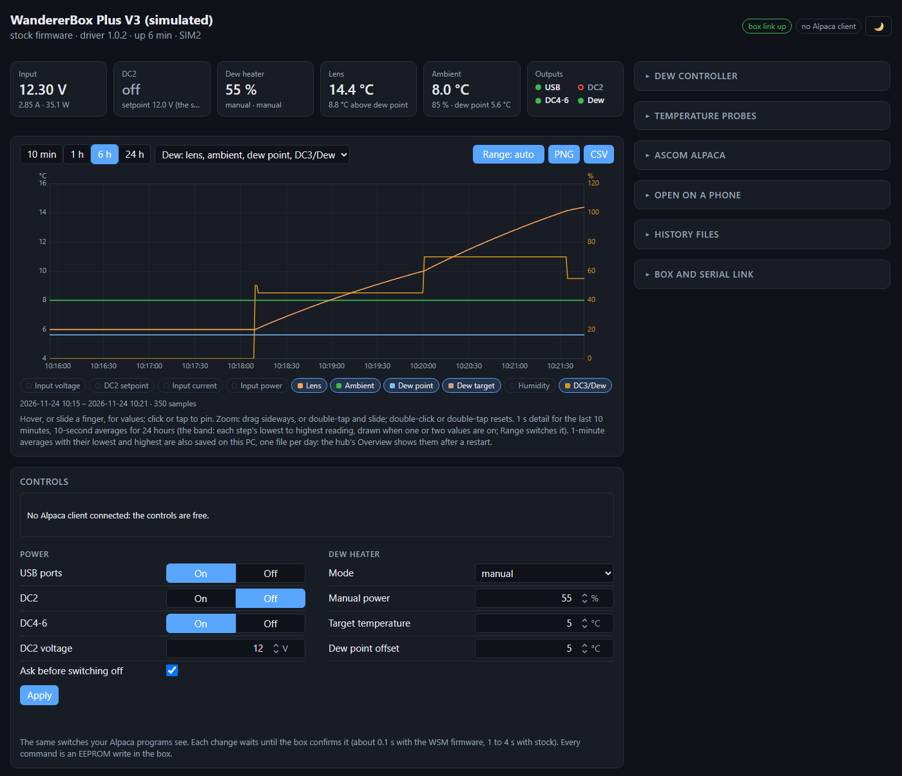

# What it does

[Guide](README.md) › What it does

## One program, one address

Each device on a telescope PC usually comes with its own driver or service, its own settings window and, for Alpaca,
its own network address. Alpaca Hub replaces those with one program:

- **It finds your devices.** Every 15 seconds it looks at the serial (COM) ports and recognises the devices it has a
  driver for. A device plugged in later appears by itself. Unplug one and it is left out; plug it back in and it
  returns with the same settings.
- **It serves them over ASCOM Alpaca, at one address.** Your imaging program finds every device through Alpaca
  discovery, or at `http://<this PC>:11111/`. Focusers, rotators, switches, the cover and the weather readings all
  come from the same place.
- **It gives each device a page.** The status page has an Overview and a tab per device that is present: readings,
  a chart, controls and settings. It works in any browser, also on a phone or tablet on your home network.
- **It keeps a history.** Every device's readings are charted and saved to a file per day, so you can look back at a
  night's temperatures, dew heater power or focuser positions.



## What you get

- **Device numbers that stay put.** Focuser #0, #1 … are counted across all brands and saved, so the profile in your
  imaging program stays valid on a night when one device is missing.
- **A device that crashes doesn't take the others with it.** Each driver runs in its own process. If one fails, the
  hub starts it again; the other devices carry on, and a program that was connected is connected again.
- **Careful with your devices.** The hub never opens a port no driver claims (a Bluetooth COM port, a meter's cable),
  listens before it talks, and only asks a port that stayed silent. The WandererBox, which stores everything it
  receives, is recognised without a byte being sent to it.
- **Controls that don't fight your imaging program.** While a program is connected to a device, its page locks the
  controls. *Unlock* lets you change something deliberately.
- **Night mode.** The 🌙 button turns every page red, to keep your eyes dark-adapted.
- **Updates.** The hub tells you when a new version exists and can install it ([Updates](6-updates.md)).
- **No ASCOM Platform needed.** Programs that speak Alpaca use the hub directly. Only a program that knows classic
  ASCOM drivers but not Alpaca needs the ASCOM Platform ([Imaging programs](5-alpaca-programs.md)).

## How it fits together

```
Imaging program  ─┐                       ┌─► NiteCrawler driver    Focuser, Rotator
Phone / browser  ─┼─► Alpaca Hub :11111 ──┼─► WandererBox driver    Switch, ObservingConditions
Other PCs        ─┘   (one address,       ├─► WandererCover driver  CoverCalibrator
                       discovery, pages)  └─► Optec driver          Focuser, Rotator
```

The hub itself holds no device code. Each kind of device has a driver with its own installer: install only the ones
you need, and update one without touching the others.

Next: [Installing](2-install.md)
