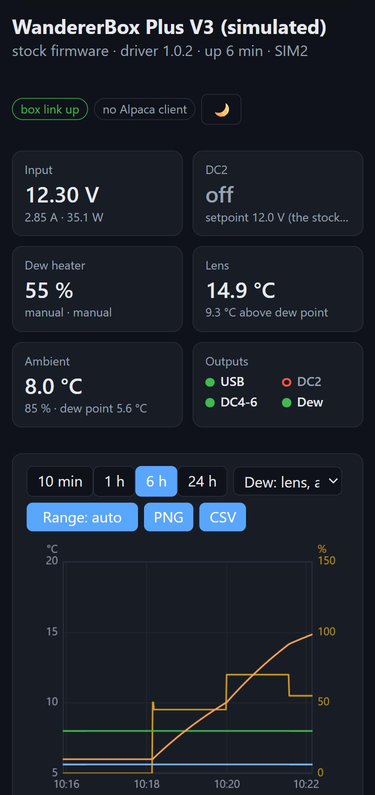

# Installing

[Guide](README.md) › Installing

## What you need

- A Windows 10 or 11 PC (64-bit): the telescope PC the devices are plugged into.
- The devices on USB, powered.
- Nothing else: Python, .NET and the ASCOM Platform are not needed.

## 1. Download

From the [latest release](https://github.com/ScaleDIN/alpaca-hub/releases/latest), download:

- **The hub:** `AlpacaHub-<version>-Setup.exe`.
- **A driver for each kind of device you have:** `AlpacaHub-<driver>-<version>-Setup.exe`, where the driver is
  `nitecrawler`, `wbox`, `wcover` or `optec` ([which is which](README.md#supported-devices)).

## 2. Install the hub, then the drivers

Run the hub's installer first. The installers aren't code-signed yet, so Windows may warn about an unknown
publisher: choose *More info*, then *Run anyway*. Windows also asks for administrator rights.

The hub's installer offers three options:

| Option | What it does |
|---|---|
| Desktop shortcuts | *Alpaca Hub* and *Stop Alpaca Hub* on the desktop (they're in the Start menu either way). |
| Start automatically when Windows starts | Starts the hub when someone logs on. |
| Let phones and other computers use the devices | A firewall rule for **Private** networks only, so a phone or another PC at home can reach the hub. |

Then run the driver installers, in any order. They can be installed while the hub runs: it picks a new driver up
within seconds.

Removing: Windows *Settings › Apps*, "Alpaca Hub" for the hub, "Alpaca Hub driver: …" for each driver. Removing the
hub leaves the drivers installed.

## 3. Before the first start

- **Close other programs that use the devices' ports**, such as an older Alpaca service for the device or the
  vendor's own tool. Only one program can have a COM port open.
- **Coming from the devices' older standalone services** (the NiteCrawler Alpaca service, WBPlus Stock Alpaca)?
  Stop and uninstall them first. On its first start the hub takes over their settings once: check them on each
  device's page before moving anything (the focus maximum on the NiteCrawler's page, the dew heater settings on the
  box's page). The WandererBox stores every command it receives, so its page is the place to set the dew heater the
  way you want it.

## 4. Start it

Start menu › **Alpaca Hub** starts the hub and opens its page at
[http://localhost:11111/](http://localhost:11111/). If it already runs, it just opens the page.

| Start menu entry | What it does |
|---|---|
| Alpaca Hub | Starts the hub and opens its page. |
| Stop Alpaca Hub | Stops it cleanly: each driver stops its device first. |
| Settings and log folder | Opens `%LOCALAPPDATA%\alpaca-hub` (each device's settings, the logs). |
| Allow network access (firewall) | Lets other computers in again if Windows blocked the hub (below). |
| User guide | The short guide installed with the hub. |

## Phones and other computers

The page works on a phone or tablet too. Each device page has **Open on a phone**, with a QR code for the hub's
address on your network.

Windows calls each network either **Private** (your home network) or **Public** (a café, a hotel). On a Private
network, phones and other computers can use the devices through the hub; on a Public one only programs on this PC
can. To share the devices, set this PC's network to Private: Windows *Settings › Network & internet › your
connection › Network profile type*.

If Windows Firewall asks on the first start, **don't allow Public networks**: set the network to Private instead.
If other computers still can't reach the hub after that, Start menu › *Allow network access (firewall)* fixes it.

Next: [The Overview](3-overview.md)
