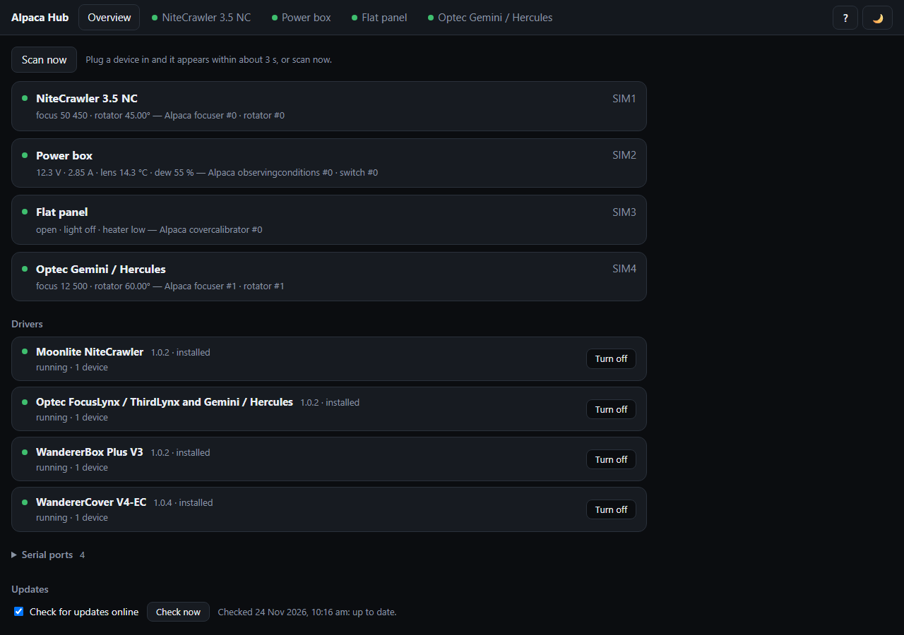
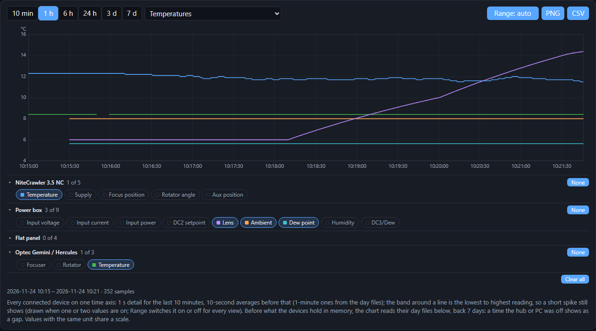
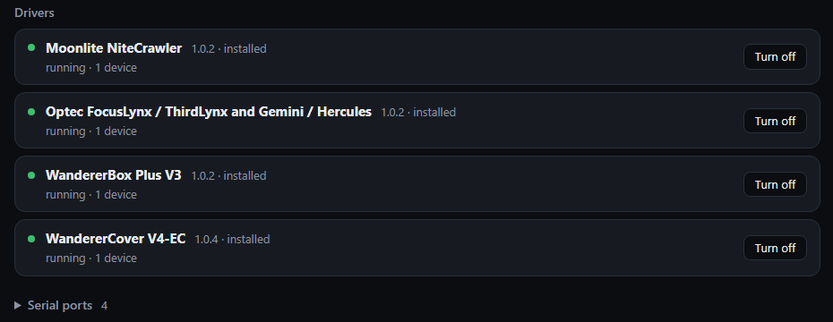

# The Overview

[Guide](README.md) › The Overview

The hub's page opens on the **Overview**. The bar at the top has a tab for each device that is present, the user
guide (**?**) and night mode (🌙).

## Devices

Each device found is listed with its port, a short status (position, voltage, cover state …) and the numbers your
imaging program sees it under, for example *Alpaca focuser #0 · rotator #0*. The dot is green when all is well,
amber or red when the device needs a look. Click a device to open its tab.

**Scan now** looks at the serial ports at once. The hub does that every 15 seconds anyway, so a device you plug in
appears by itself.

## The chart of everything

Below the devices, one chart shows the readings of every device on one time axis.

- **Time range:** 10 min, 1 h, 6 h, 24 h, 3 days, 7 days. Drag across the chart to zoom in; double-click (or
  *Reset zoom*) to see the whole range again.
- **What to show:** ready-made views (*Temperatures*, *Power*, *Positions*, *Dew*) or *Custom*, where you tick any
  mix of values, grouped by device. Values with the same unit share a scale.
- **Range:** each point is a step of a few seconds; with one or two values on, a band around the line shows the
  lowest and highest reading in each step, so a short spike still shows. *Range* switches the band on or off.
- **PNG** saves the chart as shown; **CSV** gives you the numbers in view.

The last 10 minutes are kept second by second, the last 24 hours in 10-second steps, and older days come from the
saved history files.

## Saved history

Every device's readings are also written to a file per day (1-minute averages, with each minute's lowest and
highest). The **Saved history** card lists them by device: download one day, a whole device as a zip, or plot a file
saved earlier with **Open CSV…**. On the hub's PC, **Open folder** shows them in Explorer. One setting keeps them for
1 to 365 days, for every device. The files are plain CSV, so a spreadsheet opens them too.

## Drivers

Every installed driver, with its version and state: running, starting, restarting, failed, off or refused.

- **Turn off** stops a driver and frees its ports until you turn it on again (also after a restart).
- A driver that failed several times shows why, its last log lines and **Try again**.
- A newer version waiting for your imaging program to disconnect shows **Switch now**.
- With two or more units of a kind, each keeps its tab name ("ZWO EFW #2") for good, also while it's unplugged.
  When one is gone for good, its driver shows **Renumber tabs**: it forgets the units that aren't plugged in and
  numbers the others 1, 2, 3 again, so a new unit doesn't end up as "#4". Not while an imaging program is
  connected to them; their Alpaca numbers and settings stay as they are.
- **Rename** on a device's card gives it a name of your own (its tab, its card and Saved history show it; empty
  brings back the usual one). Without one, a name stored in the device itself is shown, such as the custom ID set
  with ZWO's software.
- The Alpaca numbers are kept the same way. When some are kept for devices that are gone, **Renumber Alpaca
  numbers** under the devices numbers the ones here 0, 1, 2 per kind. It shows what changes and asks first: an
  imaging program that chose a device by its number must choose it again.
- A driver written for a newer hub is *refused*, with the reason: update the hub first.

## Serial ports

Fold it open to see every COM port and what the hub made of it: in use (by which device), no driver for its USB
chip (never opened), not recognised, or stuck in Windows' serial driver.

**Ignore** keeps the hub away from a port for good, for example a meter's USB cable or a device another program
uses: never opened, never probed, also after a restart. A port whose USB chip has a serial number stays ignored on
any COM number. **Stop ignoring** undoes it.

## Updates

At the bottom: whether the hub looks for new versions online, when it last did, and **Check now**. When there is a
new version, a line at the top of the Overview says so. See [Updates](6-updates.md).

Next: [Device pages](4-devices.md)
