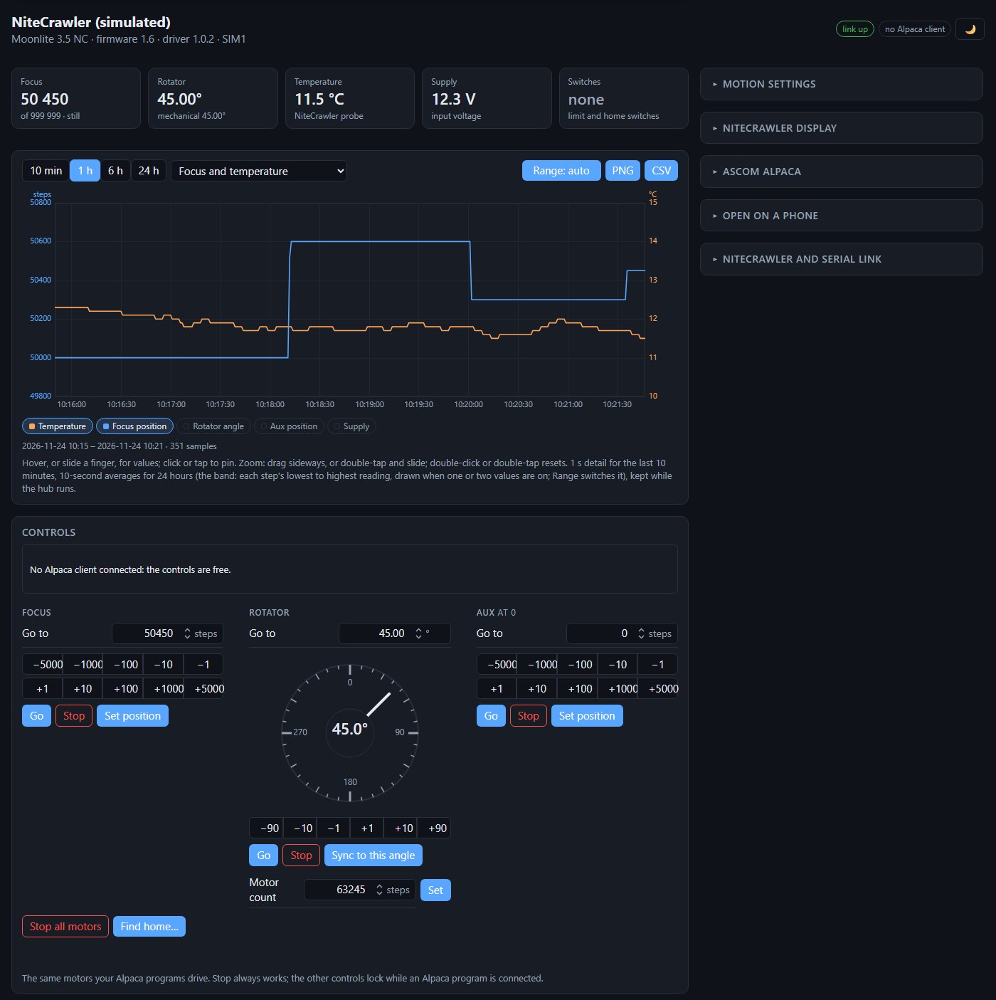
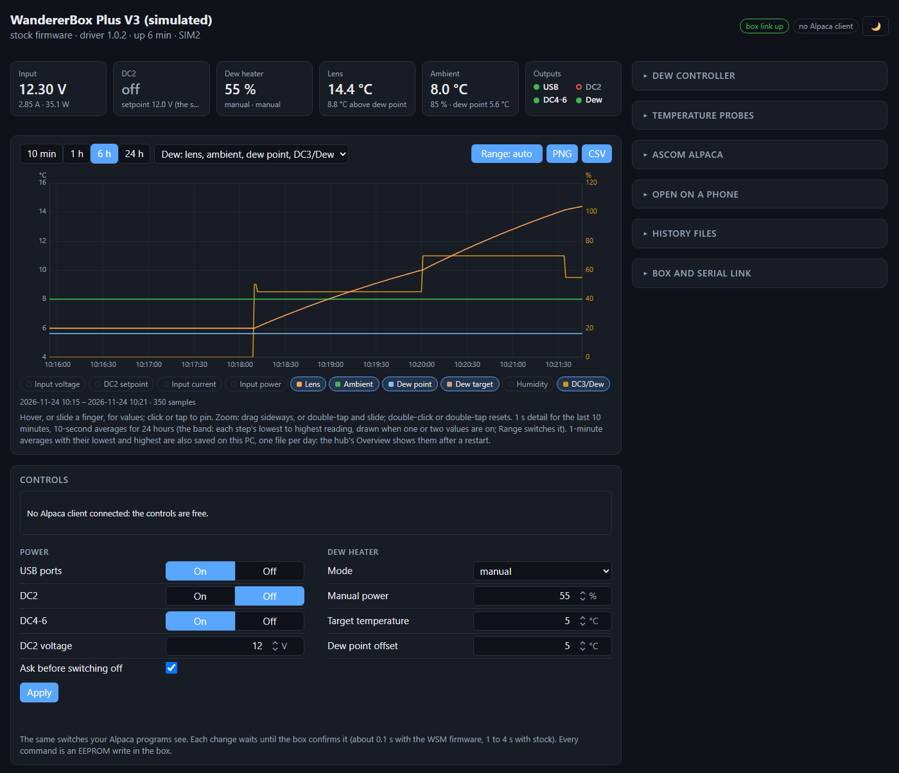
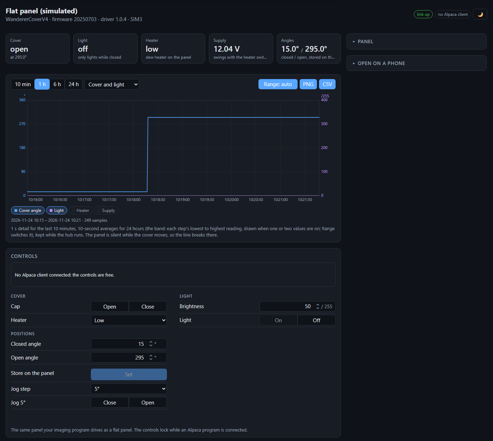
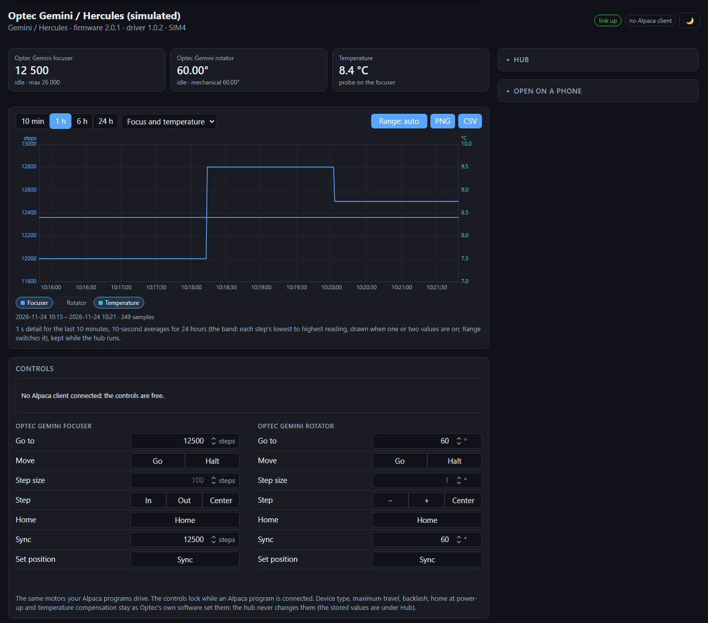

# Device pages

[Guide](README.md) › Device pages

Each device that is present has a tab. Every device page has the same layout:

- **The header:** the device's name, its firmware, and two status pills. *Link* is the serial connection between
  the PC and the device. *Client* says whether an imaging program is connected to it.
- **Tiles:** the main readings at a glance.
- **A chart** of its readings, with the same time ranges, views, band, PNG and CSV as the
  [Overview's chart](3-overview.md#the-chart-of-everything).
- **Controls:** the same motors and outputs your imaging program uses. While a program is connected they lock, so a
  click on the page can't spoil an exposure; *Unlock* lets you change something deliberately.
- **Settings** that belong to the device, and **Open on a phone** with a QR code.

Settings are saved per device, by its serial number where it has one. They come back when you plug it in again.

## Moonlite NiteCrawler

- **Focuser and rotator:** go to a position or angle, or step by ±1 to ±5000 steps (±1 to ±90° for the rotator, on
  a dial). *Set position* and *Sync to this angle* tell the NiteCrawler where it is without moving; *Find home…*
  homes the motors. **Stop** and *Stop all motors* halt them, also while homing, and are never locked.
- **The aux motor** has the same controls, and can be served as a second focuser (Alpaca Focuser #1).
- **Motion settings:** the focus maximum, backlash for each motor, and the rotator's direction (*Reverse* turns the
  angle the other way for your imaging program; the sky angle stays where it is).
- **The NiteCrawler's display:** backlight brightness while in use and after it dims (keep that low at night).
- Readings: focuser, rotator and aux positions, the NiteCrawler's temperature probe, supply voltage, limit and home
  switches.

## WandererBox Plus V3 power box

- **Outputs:** the USB ports' power, DC2 (on/off and its voltage) and DC4–6. Your imaging program sees these as
  switches. *Ask before switching off* guards against cutting power to a camera by accident.
- **Dew heater** (on the DC3 jack), in one of these modes:

  | Mode | What it does |
  |---|---|
  | Off | No heating. |
  | Manual | A fixed power you choose. |
  | Constant temperature | Holds the lens at a temperature you choose (needs the lens probe). |
  | Dew point offset | Holds the lens a number of degrees above the dew point (needs the lens probe and the ambient sensor). |
  | DC3 as a 12 V output | The jack as a plain on/off 12 V output, no heating control. |

  A maximum power applies to every mode. Small automatic changes aren't sent to the box, to spare its memory.
- **Readings:** input voltage, current and power, lens temperature, ambient temperature, humidity, dew point, and how
  far the lens is above the dew point. Your imaging program sees the weather readings as ObservingConditions. Choose
  which readings the box serves, and what it reports when a probe is missing.
- **History files:** download, open the folder, or clear them.

## WandererCover V4-EC flat panel

- **Cover:** open, close, or jog it a step (1 to several degrees) either way. A move that stops short (something in
  the way) is reported as an error with the angle it stopped at, not as open or closed.
- **Light:** on with a brightness (0 to 255), or off, for flats. The panel lights only while the cover is closed.
  Your imaging program sees cover and light as a CoverCalibrator.
- **Positions:** the closed and open angles, stored on the panel with *Set*.
- **Heater:** the panel's own dew heater, four levels.
- Readings: cover angle, light, heater, supply voltage.

## Optec Gemini / Hercules and FocusLynx / ThirdLynx

- **Focuser and rotator:** go to a position or angle, *Halt*, step in and out (− and + for the rotator) by a step
  size you choose, or go to the centre (the middle of the focuser's travel, the rotator's mechanical zero). *Home*
  homes a motor; *Sync* tells it where it is without moving. Your imaging program sees a Focuser and a Rotator
  (FocusLynx: one or two Focusers).
- **Readings:** positions, temperature (with Optec's temperature probe plugged in).
- **Stored settings, read-only:** device type, maximum travel, backlash, home at power-up and temperature
  compensation are shown under *Hub* as Optec's own software set them. The hub never changes them.

Next: [Imaging programs](5-alpaca-programs.md)
