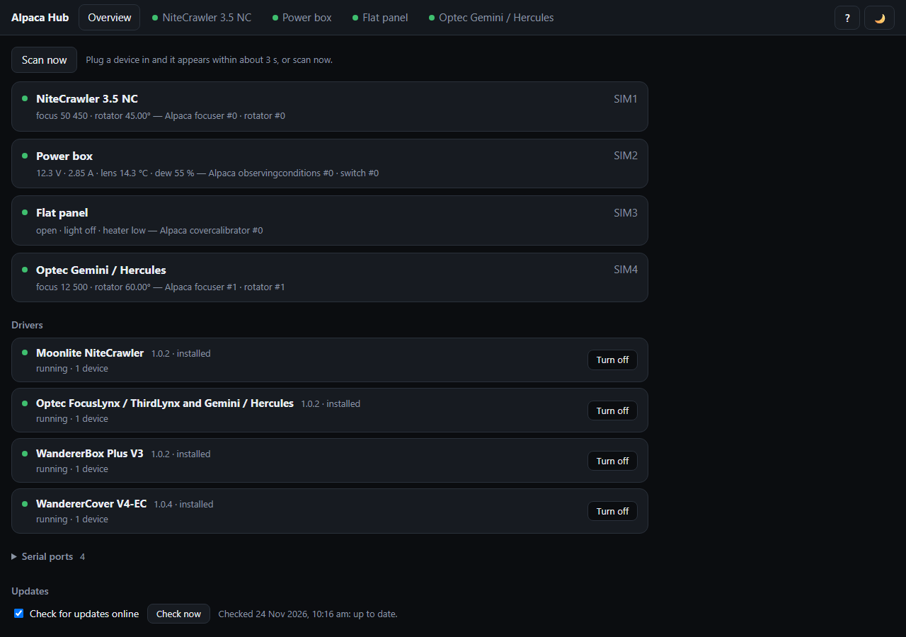

# Alpaca Hub guide

Alpaca Hub is one program for every astronomy device on your telescope PC. It finds what's plugged in, serves it to
your imaging program over ASCOM Alpaca, and gives each device a page in your browser, on the PC or on a phone.

## Pages

1. [What it does](1-what-it-does.md): what the hub is, what you get, how it fits with your imaging program.
2. [Installing](2-install.md): downloading, the hub and its drivers, the first start, phones and other PCs.
3. [The Overview](3-overview.md): devices, the chart of everything, saved history, drivers and serial ports.
4. [Device pages](4-devices.md): what each device's page shows and lets you do.
5. [Imaging programs](5-alpaca-programs.md): connecting over Alpaca, device numbers, classic ASCOM programs.
6. [Updates](6-updates.md): how the hub finds new versions, and installing them.
7. [When something doesn't work](7-troubleshooting.md).

## Supported devices

| Device | What your imaging program sees | Driver |
|---|---|---|
| Moonlite NiteCrawler (WR25 / WR30 / WR35) | Focuser, Rotator (and the aux motor as a second Focuser) | `nitecrawler` |
| WandererBox Plus V3 power box | Switch (outputs, dew heater), ObservingConditions (temperature, humidity, dew point) | `wbox` |
| WandererCover V4-EC flat panel | CoverCalibrator (cover, light) | `wcover` |
| Optec Gemini / Hercules | Focuser, Rotator | `optec` |
| Optec FocusLynx / ThirdLynx | Focuser (one or two) | `optec` |
| ZWO EAF (and EAF 5V) | Focuser | `zwoeaf` |
| ZWO EFW filter wheel | FilterWheel | `zwoefw` |

Another device can have its driver added without changing the hub: see
[Writing a driver](../WRITING-DRIVERS.md).

The screenshots in this guide come from the hub's built-in simulator, so ports show as `SIM1`, `SIM2` … instead of
`COM` numbers.
